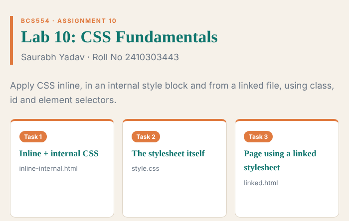
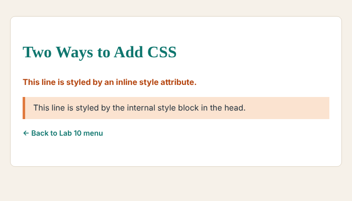
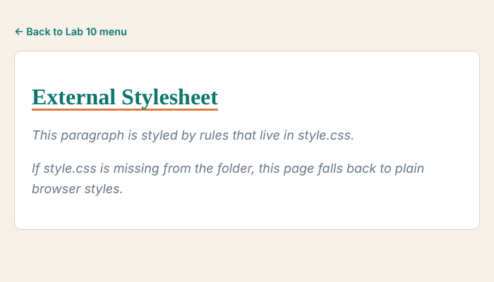

# Lab 10 - CSS Fundamentals

Name: Saurabh Yadav  
Roll No: 2410303443  
Assignment: 10

**Aim:** Apply CSS in three ways (inline, internal and linked) and use selectors and text styles.

## Tasks

| Task | File |
|------|------|
| Task 1 | `inline-internal.html` |
| Task 2 | `style.css` |
| Task 3 | `linked.html` |

**Note:** `style.css` is the file for Task 2. It is also used by `linked.html` and the menu page.

## Output

Menu page:

Task 1 - `inline-internal.html`:

Task 3 - `linked.html`:

## How to run

Open `index.html` in a browser and click the task links.
