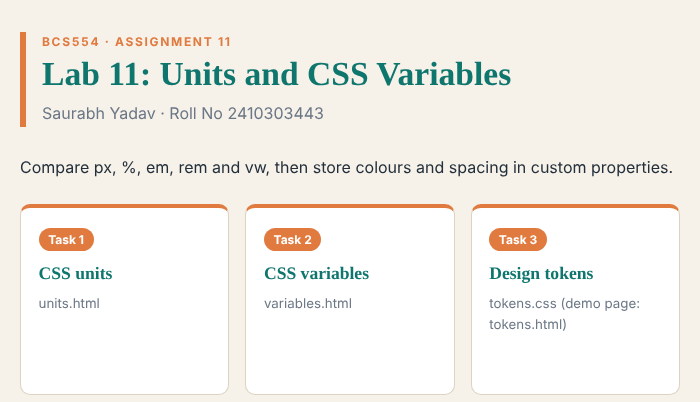
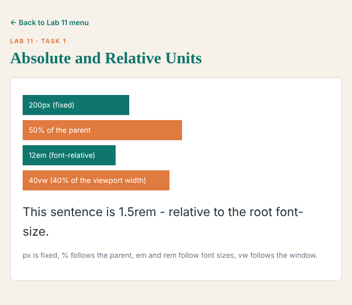
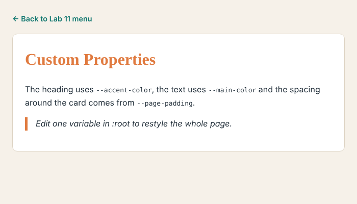
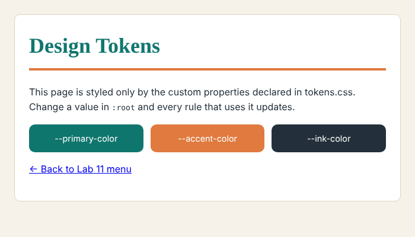

# Lab 11 - Units and CSS Variables

Name: Saurabh Yadav  
Roll No: 2410303443  
Assignment: 11

**Aim:** Use CSS units and store colours and spacing in variables.

## Tasks

| Task | File |
|------|------|
| Task 1 | `units.html` |
| Task 2 | `variables.html` |
| Task 3 (demo page) | `tokens.html` |
| Task 3 | `tokens.css` |

**Note:** `tokens.css` is the file for Task 3. `tokens.html` is a small page that links it.

## Output

Menu page:

Task 1 - `units.html`:

Task 2 - `variables.html`:

Task 3 (demo page) - `tokens.html`:

## How to run

Open `index.html` in a browser and click the task links.
