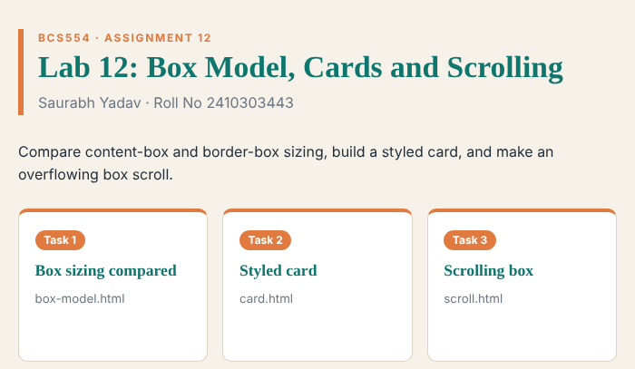
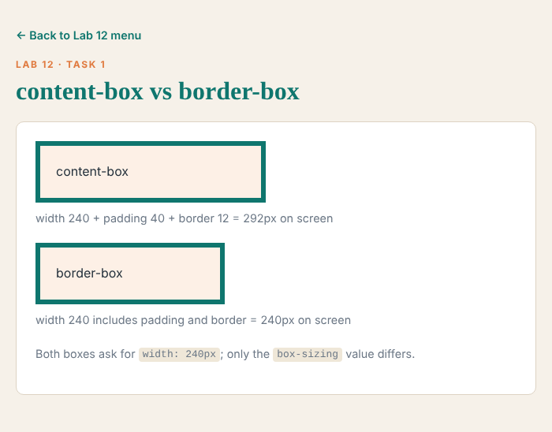
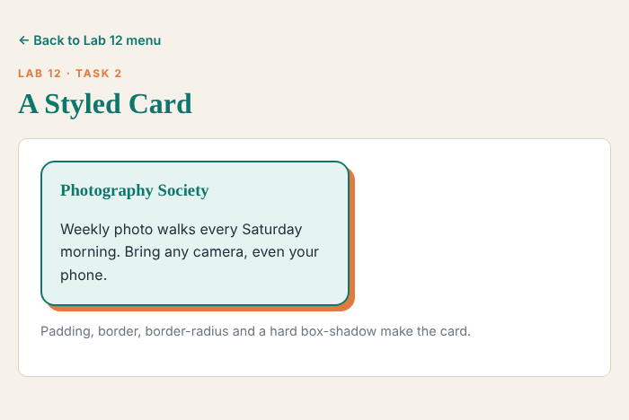
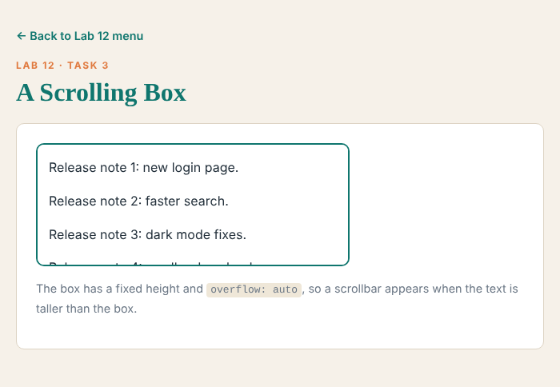

# Lab 12 - Box Model, Cards and Scrolling

Name: Saurabh Yadav  
Roll No: 2410303443  
Assignment: 12

**Aim:** Compare the box sizing types, style a card and make a box scroll.

## Tasks

| Task | File |
|------|------|
| Task 1 | `box-model.html` |
| Task 2 | `card.html` |
| Task 3 | `scroll.html` |

## Output

Menu page:

Task 1 - `box-model.html`:

Task 2 - `card.html`:

Task 3 - `scroll.html`:

## How to run

Open `index.html` in a browser and click the task links.
