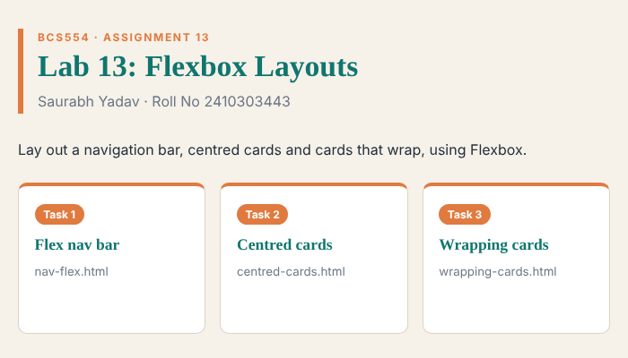
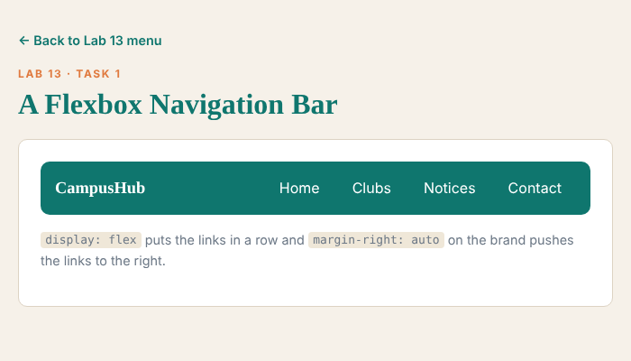
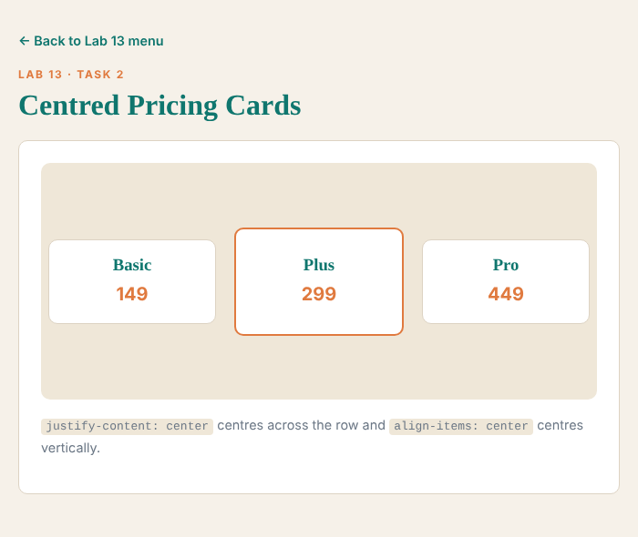
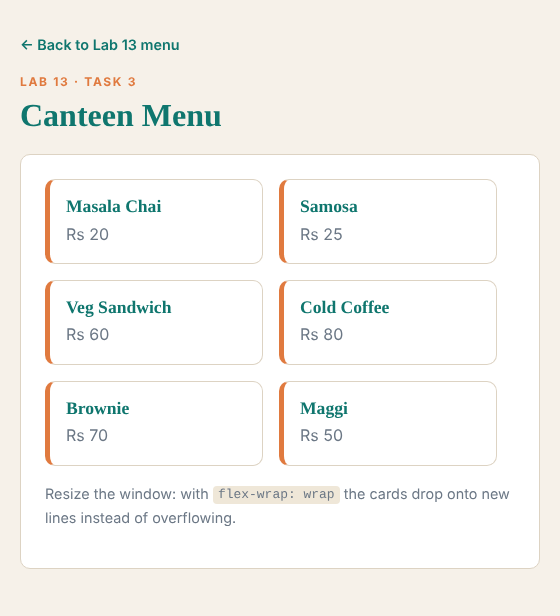

# Lab 13 - Flexbox Layouts

Name: Saurabh Yadav  
Roll No: 2410303443  
Assignment: 13

**Aim:** Lay out a navigation bar, centred cards and cards that wrap, using Flexbox.

## Tasks

| Task | File |
|------|------|
| Task 1 | `nav-flex.html` |
| Task 2 | `centred-cards.html` |
| Task 3 | `wrapping-cards.html` |

**Note:** Open `wrapping-cards.html` and narrow the browser window to see the cards wrap.

## Output

Menu page:

Task 1 - `nav-flex.html`:

Task 2 - `centred-cards.html`:

Task 3 - `wrapping-cards.html`:

## How to run

Open `index.html` in a browser and click the task links.
