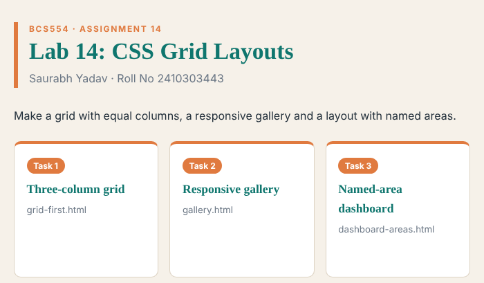
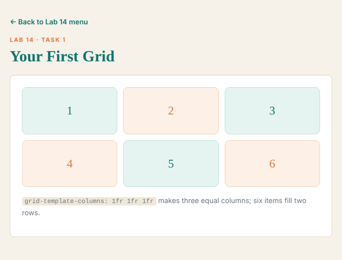
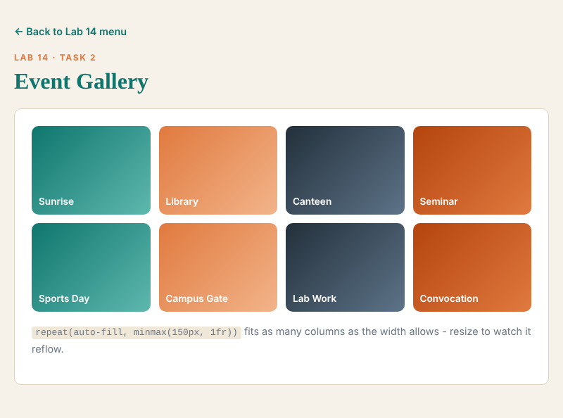
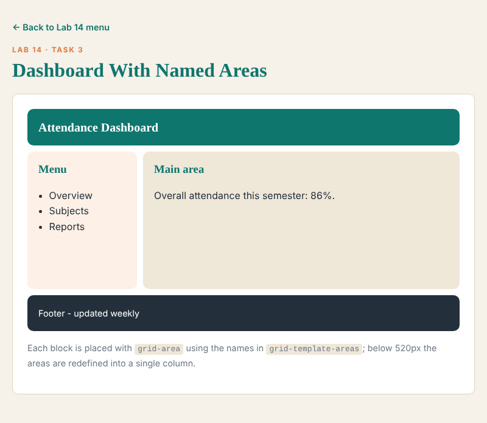

# Lab 14 - CSS Grid Layouts

Name: Saurabh Yadav  
Roll No: 2410303443  
Assignment: 14

**Aim:** Make a grid with equal columns, a responsive gallery and a layout with named areas.

## Tasks

| Task | File |
|------|------|
| Task 1 | `grid-first.html` |
| Task 2 | `gallery.html` |
| Task 3 | `dashboard-areas.html` |

## Output

Menu page:

Task 1 - `grid-first.html`:

Task 2 - `gallery.html`:

Task 3 - `dashboard-areas.html`:

## How to run

Open `index.html` in a browser and click the task links.
