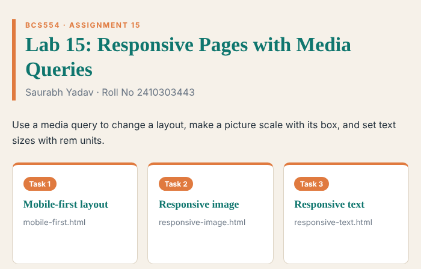
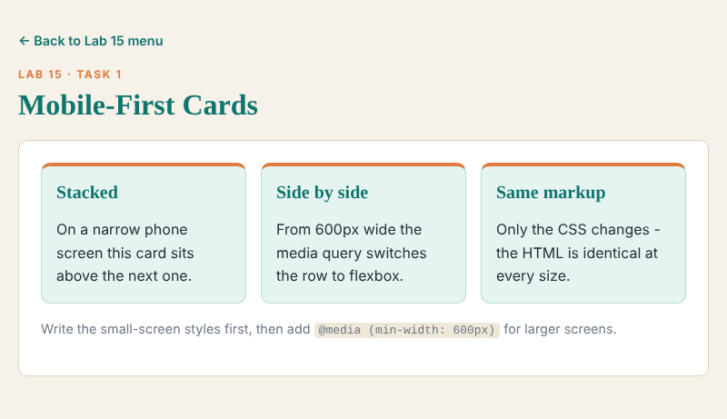
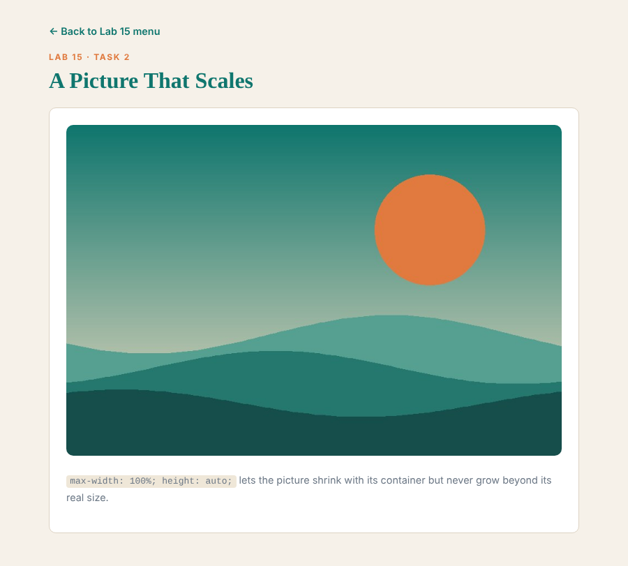
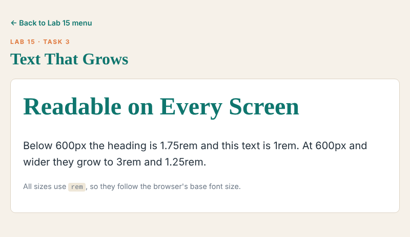

# Lab 15 - Responsive Pages with Media Queries

Name: Saurabh Yadav  
Roll No: 2410303443  
Assignment: 15

**Aim:** Use a media query to change a layout, make a picture scale with its box, and set text sizes with rem units.

## Tasks

| Task | File |
|------|------|
| Task 1 | `mobile-first.html` |
| Task 2 | `responsive-image.html` |
| Task 3 | `responsive-text.html` |

**Note:** The picture `images/photo.jpg` is a placeholder illustration. Replace it with the file given by the instructor (and change the file name in the HTML if it is different).

## Output

Menu page:

Task 1 - `mobile-first.html`:

Task 2 - `responsive-image.html`:

Task 3 - `responsive-text.html`:

## How to run

Open `index.html` in a browser and click the task links.
