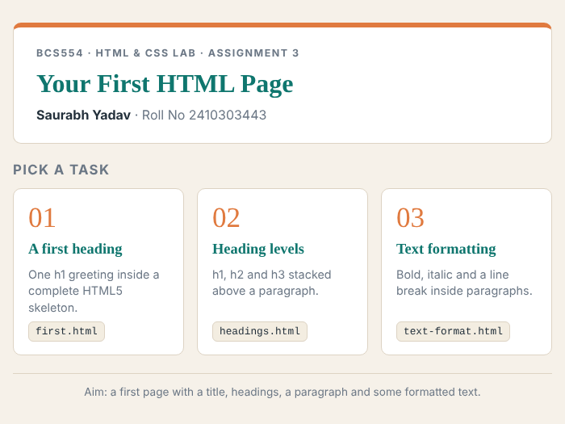
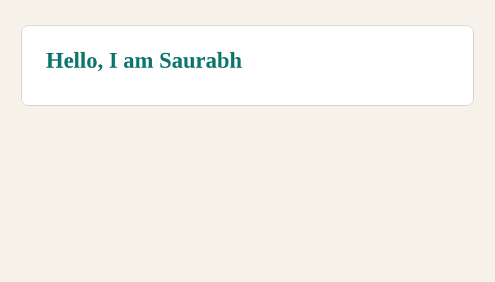
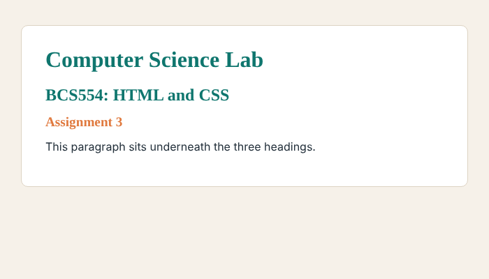
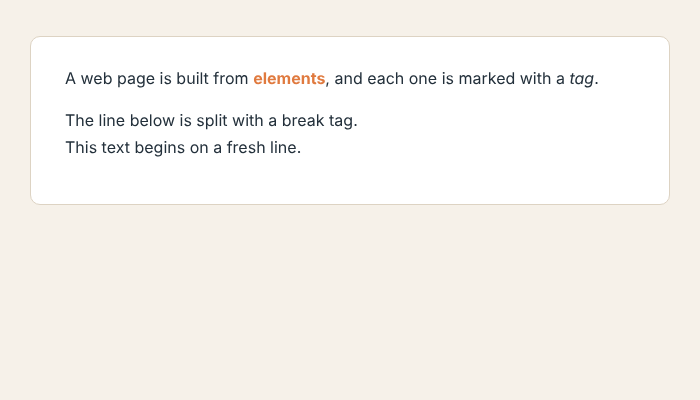

# Lab 3 - Your First HTML Page

Name: Saurabh Yadav  
Roll No: 2410303443  
Assignment: 3

**Aim:** Write a first HTML page with a title, headings and a paragraph, then format some text.

## Tasks

| Task | File |
|------|------|
| Task 1 | `first.html` |
| Task 2 | `headings.html` |
| Task 3 | `text-format.html` |

## Output

Menu page:

Task 1 - `first.html`:

Task 2 - `headings.html`:

Task 3 - `text-format.html`:

## How to run

Open `index.html` in a browser and click the task links.
