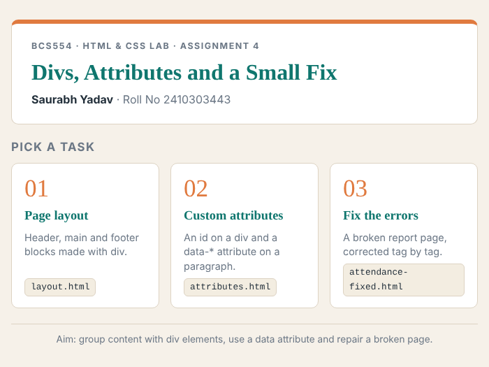
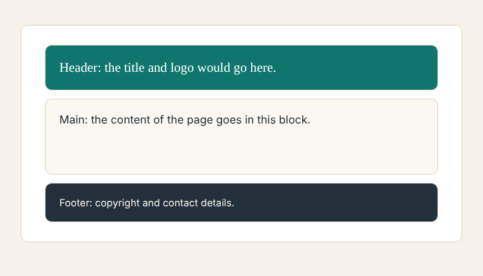
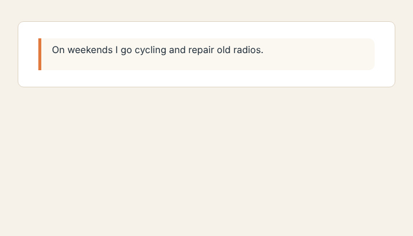
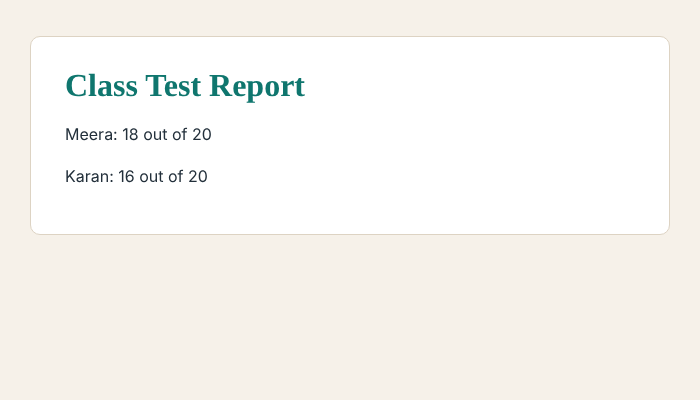

# Lab 4 - Divs, Attributes and a Small Fix

Name: Saurabh Yadav  
Roll No: 2410303443  
Assignment: 4

**Aim:** Group parts of a page with div elements, add a data attribute and repair a page that has mistakes.

## Tasks

| Task | File |
|------|------|
| Task 1 | `layout.html` |
| Task 2 | `attributes.html` |
| Task 3 | `attendance-fixed.html` |

**Note:** Mistakes fixed in attendance-fixed.html: the closing tag of the h1 had been typed as `<h1>`, and the second paragraph was never closed with `
`.

## Output

Menu page:

Task 1 - `layout.html`:

Task 2 - `attributes.html`:

Task 3 - `attendance-fixed.html`:

## How to run

Open `index.html` in a browser and click the task links.
