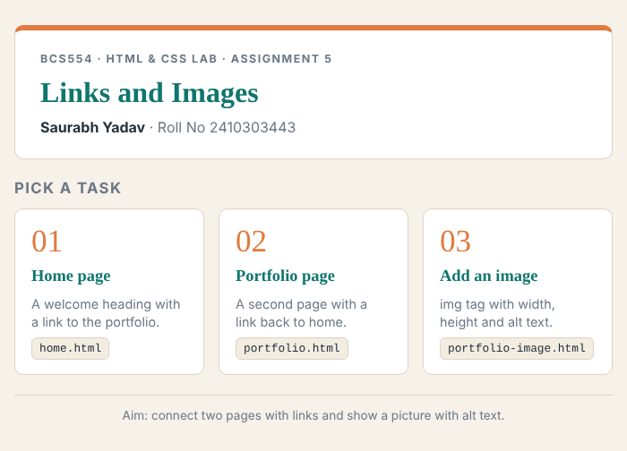
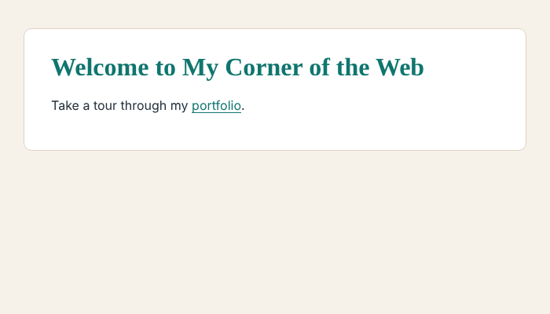
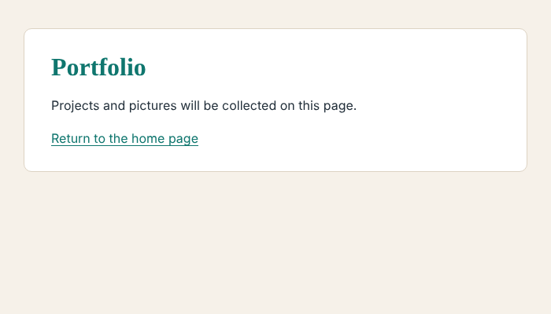
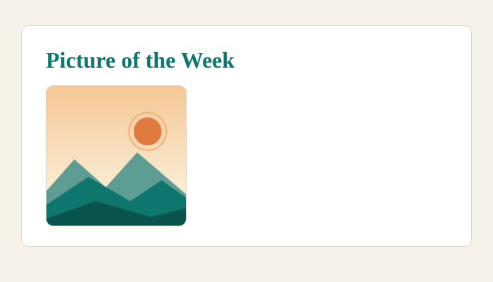

# Lab 5 - Links and Images

Name: Saurabh Yadav  
Roll No: 2410303443  
Assignment: 5

**Aim:** Link two pages together and place a picture on a page with alt text.

## Tasks

| Task | File |
|------|------|
| Task 1 | `home.html` |
| Task 2 | `portfolio.html` |
| Task 3 | `portfolio-image.html` |

**Note:** `images/photo.jpg` is a drawn illustration used as a stand-in. If the instructor supplies a picture, copy it into `images` and update the file name in `portfolio-image.html`.

## Output

Menu page:

Task 1 - `home.html`:

Task 2 - `portfolio.html`:

Task 3 - `portfolio-image.html`:

## How to run

Open `index.html` in a browser and click the task links.
