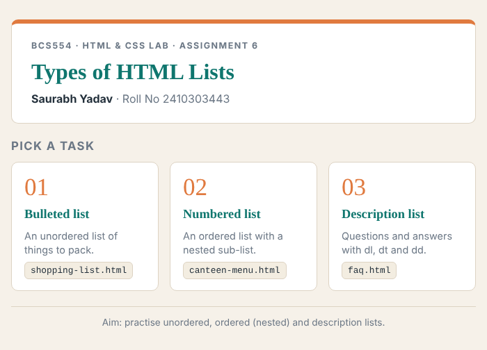
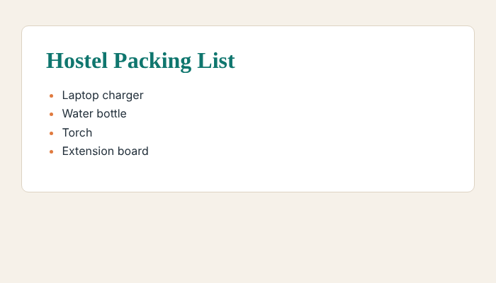
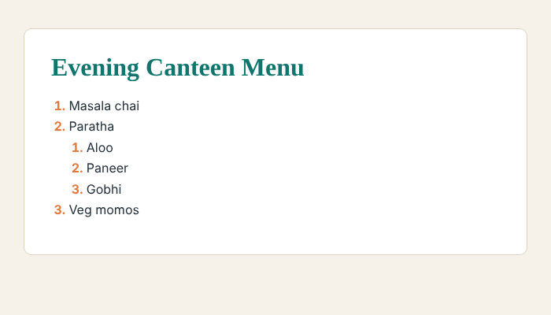
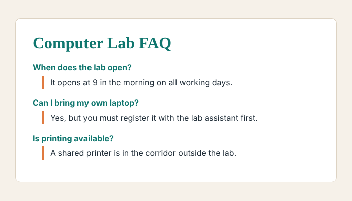

# Lab 6 - Types of HTML Lists

Name: Saurabh Yadav  
Roll No: 2410303443  
Assignment: 6

**Aim:** Create a bulleted list, a numbered list with a nested list and a description list.

## Tasks

| Task | File |
|------|------|
| Task 1 | `shopping-list.html` |
| Task 2 | `canteen-menu.html` |
| Task 3 | `faq.html` |

## Output

Menu page:

Task 1 - `shopping-list.html`:

Task 2 - `canteen-menu.html`:

Task 3 - `faq.html`:

## How to run

Open `index.html` in a browser and click the task links.
