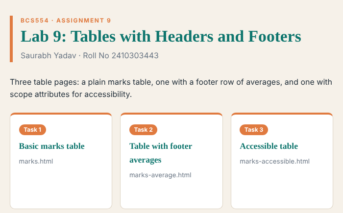
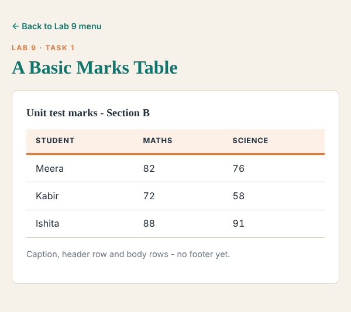
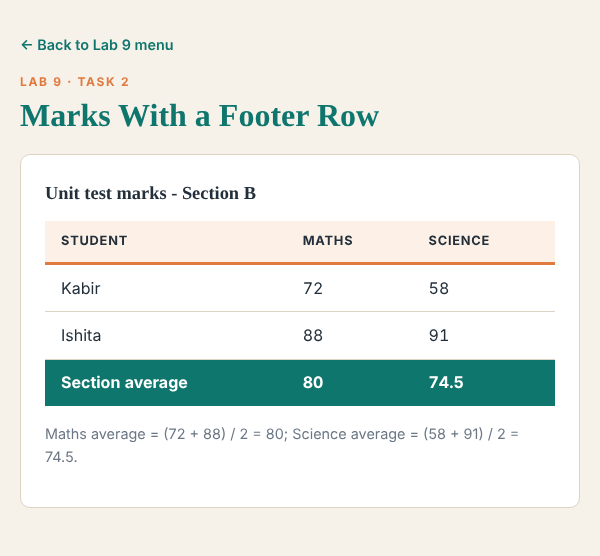
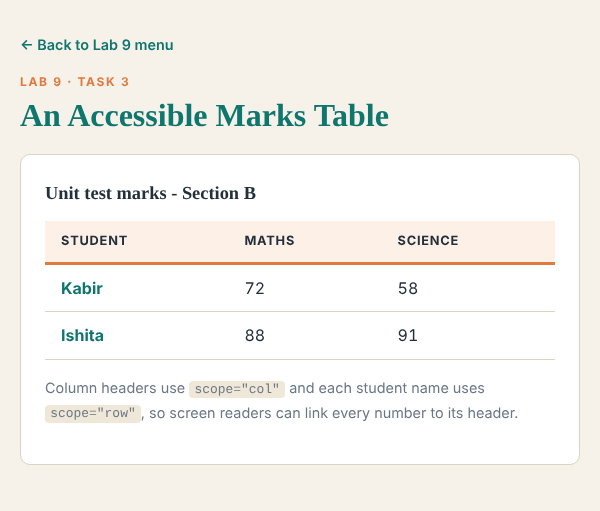

# Lab 9 - Tables with Headers and Footers

Name: Saurabh Yadav  
Roll No: 2410303443  
Assignment: 9

**Aim:** Build a table with a caption, a header, rows and a footer, and add scope attributes.

## Tasks

| Task | File |
|------|------|
| Task 1 | `marks.html` |
| Task 2 | `marks-average.html` |
| Task 3 | `marks-accessible.html` |

**Note:** `marks-average.html` footer: Maths average = (72 + 88) / 2 = 80, Science average = (58 + 91) / 2 = 74.5.

## Output

Menu page:

Task 1 - `marks.html`:

Task 2 - `marks-average.html`:

Task 3 - `marks-accessible.html`:

## How to run

Open `index.html` in a browser and click the task links.
